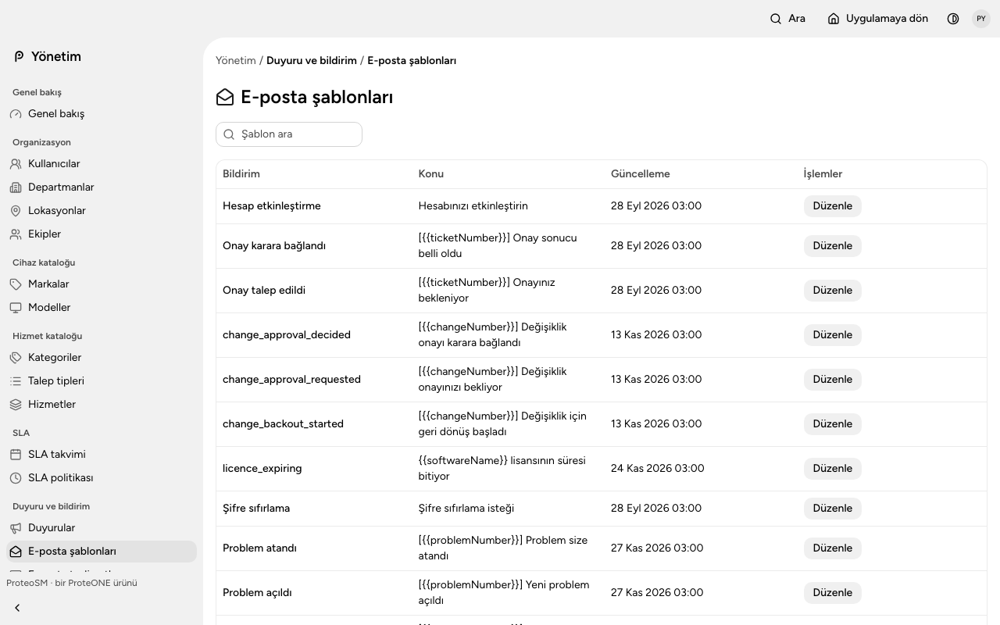
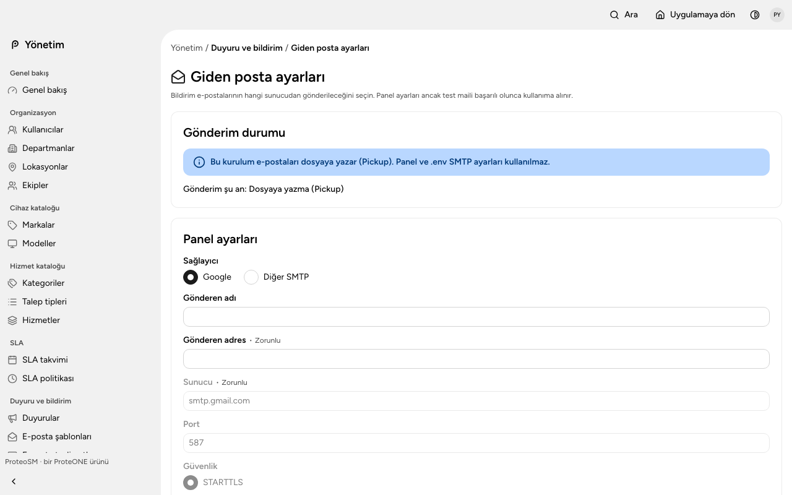
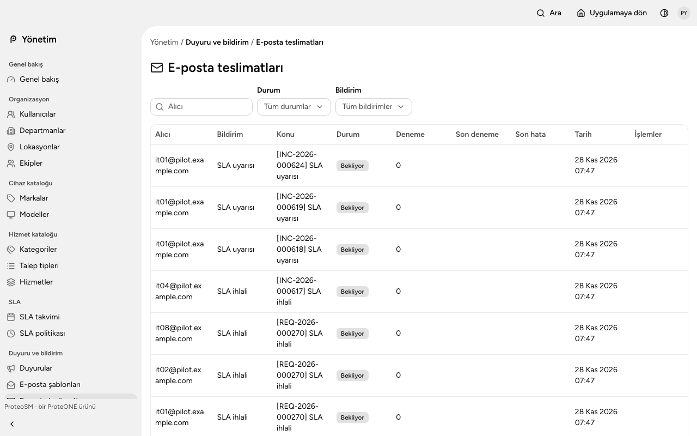
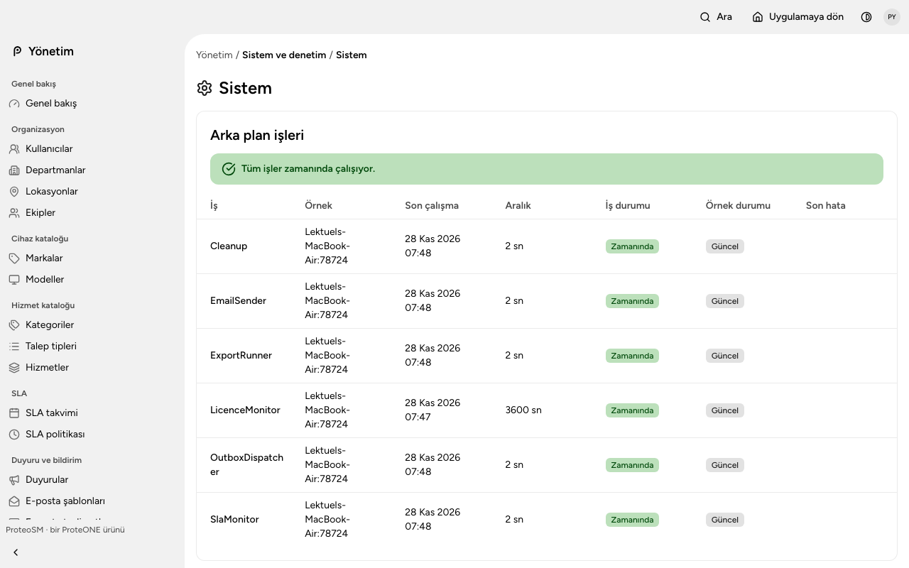
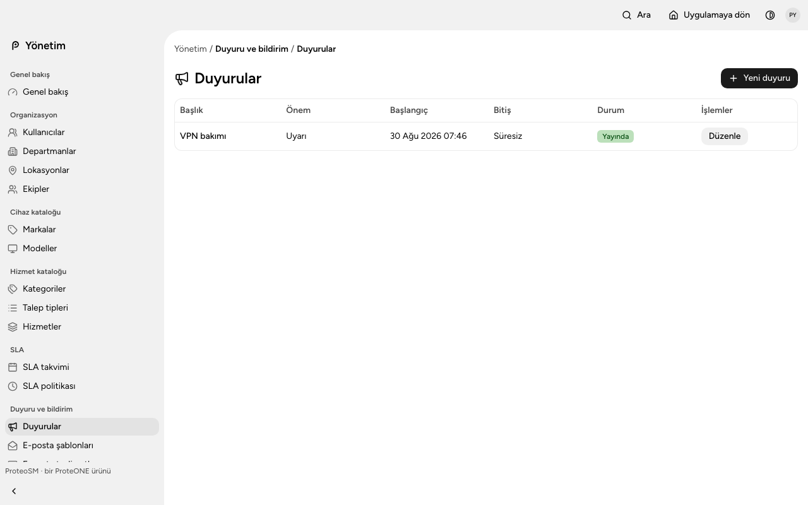
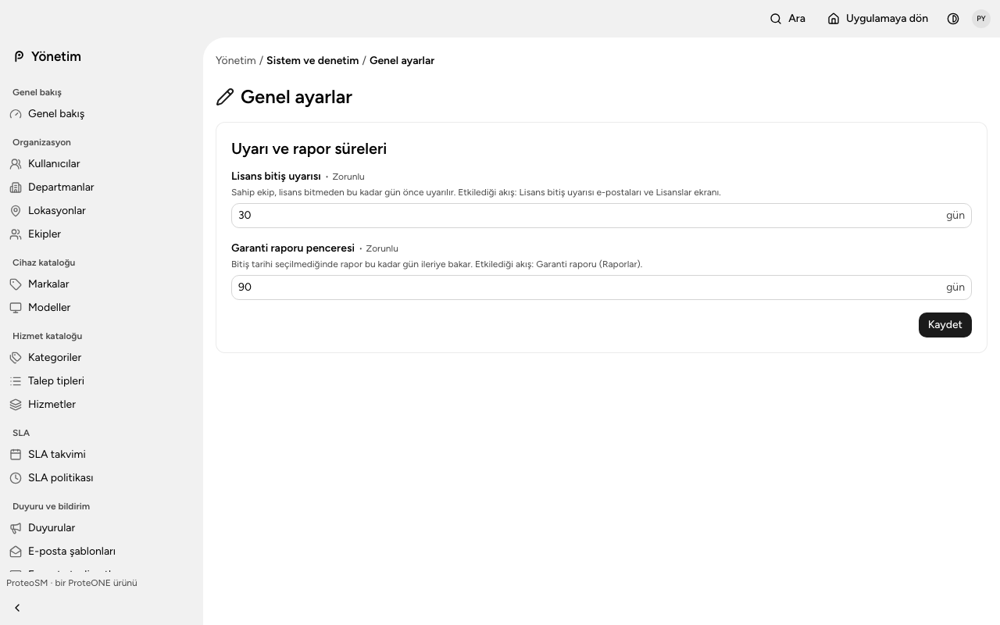
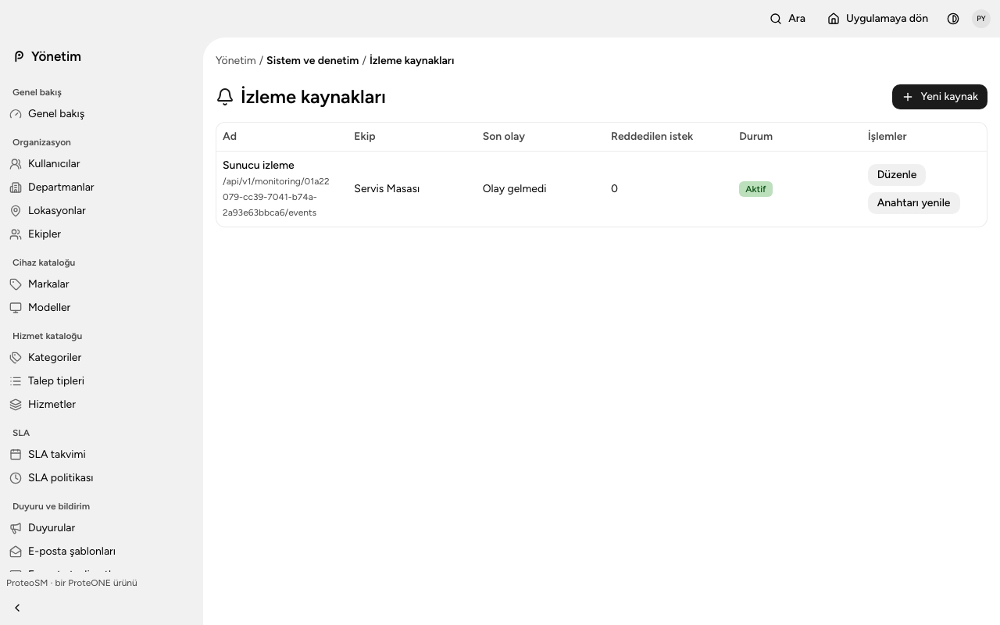

# Yönetim: e-posta ve sistem

Bu sayfa yöneticiler içindir: bildirim e-postalarının hangi sunucudan gideceğini seçmek, metinlerini düzenlemek, gönderimleri izlemek ve arka plan işlerinin çalıştığını kontrol etmek.

## E-posta şablonları

Her bildirim türünün bir şablonu vardır: "Kayıt oluşturuldu", "Kamuya açık yanıt", "Onay talep edildi", "SLA uyarısı", "Hesap etkinleştirme", "Şifre sıfırlama" gibi.

1. **E-posta şablonları** sayfasında değiştirmek istediğiniz bildirimin satırında **Düzenle** düğmesine basın.
2. **Konu** ve **İçerik** alanlarını düzenleyin.
3. Kayıt numarası, kişi adı gibi değişen bilgiler için **Kullanılabilir değişkenler** listesindeki değişkenleri kullanın. Değişkenleri çift süslü parantez içinde yazın, örneğin `{{ticketNumber}}`. Listede olmayan bir değişken yazarsanız şablon kaydedilmez.
4. **Kaydet** düğmesine basın.

Değişiklik bundan sonra gönderilen e-postalarda geçerli olur.

Düzenleme penceresindeki **Önizleme** değişkenleri örnek değerlerle doldurup şablonun nasıl görüneceğini gösterir. Önizleme e-posta göndermez ve şablonu kaydetmez. Bu olayda kullanılamayan bir değişken yazdıysanız önizleme bunları adıyla sayar; kayıt bu durumda reddedilir.

## Giden posta ayarları

**Giden posta ayarları** sayfası (menüde **Duyuru ve bildirim** altında) bildirim e-postalarının hangi sunucudan gideceğini belirler. Üstteki **Gönderim durumu** şu an kullanılan ayarı yazar: **Panel ayarları** veya .env ayarları (kurulumda girilen sunucu).

Panel ayarlarını kullanıma almak için:

1. **Sağlayıcı** seçin:
   - **Google**: Sunucu, port ve güvenlik sabittir. **Kullanıcı** alanına Google hesabını, **Şifre** alanına uygulama şifresini yazın. Google hesabında iki adımlı doğrulama açık olmalıdır.
   - **Diğer SMTP**: **Sunucu**, **Port**, **Güvenlik**, **Kullanıcı** ve **Şifre** alanlarını kendiniz doldurun. Güvenlik seçince önerilen port gelir (STARTTLS 587, SSL/TLS 465, Yok 25). **Yok** yalnızca kullanıcı adı boşken seçilebilir.
2. **Gönderen adı** ve **Gönderen adres** alanlarını doldurun ve **Kaydet**'e basın.
3. **Test maili gönder**'e basın. Test maili kayıtlı ayarlarla sizin e-posta adresinize gider. Kaydedilmemiş değişiklik varsa düğme kapalıdır.
4. Test başarılıysa **Kullanıma al**'a basın. Bildirimler bundan sonra bu ayarlarla gider.

Notlar:

- Şifre sayfada gösterilmez; alanda "kayıtlı — değiştirmek için yazın" yazar. Boş bırakırsanız kayıtlı şifre korunur. Sunucu, port, güvenlik, sağlayıcı veya kullanıcı değişirse şifreyi yeniden yazmanız gerekir.
- Test başarısızsa sayfa nedeni yazar (bağlantı, TLS, kullanıcı adı veya şifre, gönderen, alıcı, zaman aşımı) ve altında "Sunucu yanıtı" satırını gösterir.
- Kullanımdaki ayarları değiştirip kaydettiğinizde sistem önce test maili gönderir. Test başarısızsa kayıt yapılmaz ve eski ayarlar çalışmaya devam eder.
- **.env ayarlarına dön** gönderimi kurulumda girilen sunucuya geri alır. Panel ayarları silinmez.
- Bazı kurulumlar e-postaları dosyaya yazar (Pickup). Bu durumda sayfada bir uyarı görünür ve panel ayarları kullanılmaz.

## E-posta teslimatları

**E-posta teslimatları** sayfası gönderilen ve gönderilemeyen her e-postayı listeler: alıcı, bildirim, konu, durum, deneme sayısı, son hata ve **Son deneme** zamanı. **Son deneme** gönderimin en son denendiği zamandır (başarılı ya da başarısız); henüz hiç denenmemiş teslimatta boştur. Yeniden denenmek üzere sırada bekleyen teslimatta bir de "Sonraki deneme" zamanı yazar.

- **Durum**, **Bildirim** ve **Alıcı** filtreleriyle arayın.
- Durumlar: **Bekliyor**, **Gönderiliyor**, **Gönderildi**, **Başarısız**.
- **Başarısız** bir e-postayı **Yeniden dene** ile tekrar gönderime alın. Önce **Son hata** sütununu okuyun; sorun e-posta sunucusundaysa sistem yöneticisine bildirin.

Kullanıcı pasifleştirildiyse veya e-posta adresi değiştiyse eski e-posta yeniden gönderilemez. Hesap bağlantısı gerekiyorsa kullanıcıya **Şifre sıfırla** ile yeni bağlantı gönderin.

## Sistem

**Sistem** sayfası arka plan işlerinin (e-posta gönderimi, SLA izleme, dışa aktarım, temizlik) zamanında çalışıp çalışmadığını gösterir.

- Üstteki kutu genel durumu söyler: **Tüm işler zamanında çalışıyor.** ya da **Bazı işler zamanında çalışmadı.**
- **Arka plan işleri** tablosunda her iş için son çalışma zamanı, çalışma aralığı ve durum görünür. **Gecikmiş** veya **Rapor vermiyor** görürseniz e-postalar gitmiyor, SLA uyarıları çıkmıyor veya dışa aktarımlar hazırlanmıyor olabilir. Sistem yöneticisine bildirin.
- Tablo boşsa (**Henüz çalışan iş kaydı yok.**) arka plan hizmeti hiç çalışmamıştır.

Gönderim veya dışa aktarım işleri sorunluysa kutunun altında **İncelemek için** bağlantıları çıkar: **Başarısız e-posta teslimatları**, **Giden posta ayarlarını kontrol et** ve **Dışa aktarma işleri**.

**Genel bakış** sayfasındaki **Kurulum kontrolleri** de bir iş sorunluysa uyarı verir.

## Duyurular

Kesinti veya bakım gibi herkesi ilgilendiren bir mesajı **Duyurular** sayfasından yayınlayın. Duyuru, başladığında her kullanıcının ana sayfasında görünür. Formdaki **Önizleme** duyurunun başlığını, yayın aralığını ve görünümünü gösterir; **Oluştur** veya **Kaydet**'e basana kadar hiçbir şey yayınlanmaz.

1. **Yeni duyuru** düğmesine basın.
2. **Başlık**, **Mesaj** ve **Önem** alanlarını doldurun.
3. **Başlangıç** zamanını seçin. **Bitiş** boşsa duyuru süresiz kalır.
4. **Oluştur** düğmesine basın.

- Duyuru silinmez. Kaldırmak için **Düzenle** ile **Bitiş** zamanını şimdiye alın (başlangıçtan sonra olmalı).
- Ana sayfada en çok beş duyuru görünür; önce uyarılar, sonra en yeniler.

## Genel ayarlar

- **Lisans bitiş uyarısı**: sahip ekip, lisans bitmeden kaç gün önce uyarılır.
- **Garanti raporu penceresi**: bitiş tarihi seçilmediğinde garanti raporu kaç gün ileriye bakar.

Değerler 1 ile 365 gün arasında olabilir. **Kaydet** düğmesine basın. Her ayarın altında **Etkilediği akış** yazar: lisans uyarısı için lisans bitiş uyarısı e-postaları ve **Lisanslar** ekranı, garanti penceresi için **Raporlar** içindeki garanti raporu.

## İzleme kaynakları

İzleme aracı (örneğin sunucu izleme) imzalı istekle kendiliğinden arıza açabilir.

1. **İzleme kaynakları** sayfasında **Yeni kaynak** düğmesine basın.
2. **Ad**, **Ekip** ve **Talep sahibi** alanlarını doldurun; **Etki** ve **Aciliyet** seçin. **Hizmet** ve **Kategori** isteğe bağlıdır. Talep sahibi aktif IT personeli veya yönetici olmalıdır.
3. **Oluştur** düğmesine basın ve gösterilen anahtarı kopyalayın. Anahtar bir daha gösterilmez.
4. Adresi ve anahtarı izleme aracına girin. İmza örneğini sistem yöneticinize sorun.

- **Anahtarı yenile** yeni anahtar üretir; eskisi hemen geçersiz olur. Onay penceresi bunu işlemden önce söyler ("… kaynağının eski anahtarı hemen geçersiz olur.").
- Aynı uyarı açık bir arıza varken yeniden gelirse arızaya iç not düşer. Uyarı düzelince de yalnızca iç not düşer; arızayı IT kapatır.
- Bir kaynak saatte en fazla 30 yeni arıza açar.
- **Reddedilen istek** sayısı artıyorsa anahtarı, aracın saatini ve kaynağın aktif olduğunu kontrol edin.
- Bu yolla açılan arızada IT için **İzleme** alanı görünür.

## İpuçları

- Şablon metinlerini kısa tutun ve kaydı açan bağlantıyı silmeyin; kullanıcılar e-postadan kayda bu bağlantıyla gider.
- Kullanıcı "e-posta gelmedi" derse önce **E-posta teslimatları** sayfasında alıcıya göre arayın.
