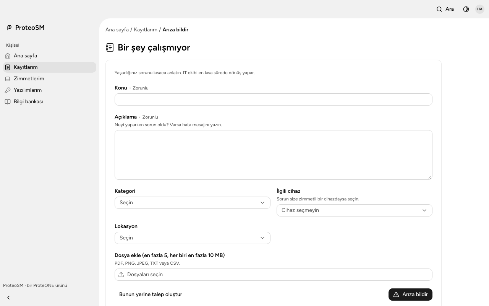
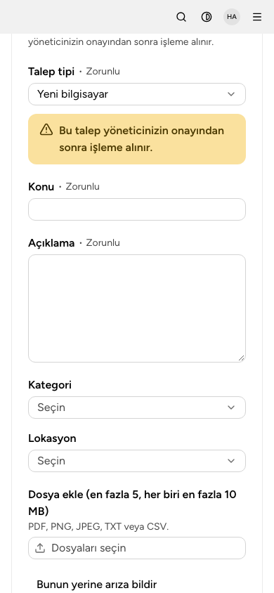

# Arıza bildirme ve talep oluşturma

Bu sayfa herkes içindir. İki tür kayıt vardır:

- **Arıza**: Bir şey bozuk veya çalışmıyor (yazıcı kağıt sıkıştırıyor, VPN bağlanmıyor). Numarası `INC-` ile başlar.
- **Talep**: Bir şey istiyorsunuz (yeni bilgisayar, yazılım lisansı, klasör erişimi). Numarası `REQ-` ile başlar.

## Arıza bildirme

1. **Ana sayfa** üzerindeki **Bir şey çalışmıyor** kartına basın. Ya da **Kayıtlarım** sayfasında **Arıza bildir** düğmesini kullanın.
2. **Konu** alanına sorunu kısa bir cümleyle yazın, örneğin "Kat yazıcısı kağıt sıkıştırıyor".
3. **Açıklama** alanına ayrıntıları yazın: neyi yaparken sorun oldu, ne zamandan beri, hata mesajı varsa tam metni. Alanın altındaki ipucu da bunu söyler.
4. **Kategori** listesinden sorunun konusunu seçin.
5. Sorun size zimmetli bir cihazdaysa **İlgili cihaz** listesinden onu seçin. Değilse **Cihaz seçmeyin** olarak bırakın.
6. **Lokasyon** listesinden bulunduğunuz yeri seçin.
7. İsterseniz **Dosya ekle (en fazla 5, her biri en fazla 10 MB)** alanından ekran görüntüsü veya belge ekleyin. PDF, PNG, JPEG, TXT veya CSV dosyaları eklenebilir.
8. **Arıza bildir** düğmesine basın.

Yanlış türü seçtiyseniz formdaki **Bunun yerine talep oluştur** bağlantısına basın. Konu, açıklama, lokasyon ve yeni türde de bulunan kategori yeni forma taşınır; kategori o türde yoksa "Seçtiğiniz kategori bu türde yok. Yeniden seçin." uyarısı çıkar ve kategoriyi yeniden seçersiniz. Talep tipi ve cihaz taşınmaz, eklediğiniz dosyalar da taşınmaz ("Dosyalar taşınmadı. Gerekirse yeniden ekleyin.").

Kayıt oluşunca kaydın sayfası açılır. Kayıt önce IT'nin kayıt alan ekibine düşer ve "P3 · Normal" öncelikle başlar. IT ekibi önceliği gerekirse değiştirir.

## Talep oluşturma

1. **Ana sayfa** üzerindeki **Bir şey istiyorum** kartına basın. Ya da **Kayıtlarım** sayfasında **Talep oluştur** düğmesini kullanın.
2. **Talep tipi** listesinden ne istediğinizi seçin, örneğin "Yeni bilgisayar".
3. **Konu**, **Açıklama**, **Kategori** ve **Lokasyon** alanlarını doldurun.
4. Gerekirse dosya ekleyin ve **Talep oluştur** düğmesine basın. Aslında bir şey bozuksa **Bunun yerine arıza bildir** bağlantısı aynı metni arıza formuna taşır.

Bazı talep tipleri yönetici onayı ister. Böyle bir tip seçtiğinizde formda sarı bir uyarı çıkar: **Bu talep yöneticinizin onayından sonra işleme alınır.**

Onay gereken talepler **Beklemede** durumunda, **Yönetici onayı bekleniyor** nedeniyle başlar. Onaylayıcı genellikle departmanınızın onaylayıcı yöneticisidir.

- Onaylanırsa talep açılır ve IT ekibi çalışmaya başlar.
- Reddedilirse talep **İptal edildi** durumuna geçer; sonucu **Onay reddedildi** olur ve red nedeni kaydın sayfasında yazar.

Her iki durumda da size e-posta gelir.

## Dosya ekleme kuralları

- Bir seferde en fazla 5 dosya, her biri en fazla 10 MB.
- Yalnızca PDF, PNG, JPEG, TXT ve CSV.
- Kayıt oluştuğu halde dosyalar yüklenemezse sayfada "Kayıt oluşturuldu ancak dosyalar yüklenemedi" uyarısı çıkar. Kayıt yine de açılmıştır; dosyaları kaydın sayfasındaki **Yazışmalar** bölümünden **Dosya ekle** ile tekrar ekleyin.

## İpuçları

- Bir kayıtta tek bir sorun anlatın. İki ayrı sorun için iki kayıt açın; böylece her biri doğru ekibe gider.
- Önce [Bilgi bankası](knowledge-base.md) sayfasına bakın; sık sorunların çözümü orada olabilir.
- "Kayıt alacak varsayılan ekip tanımlı değil" uyarısı görürseniz kayıt açılmamıştır; yöneticinize bildirin.
