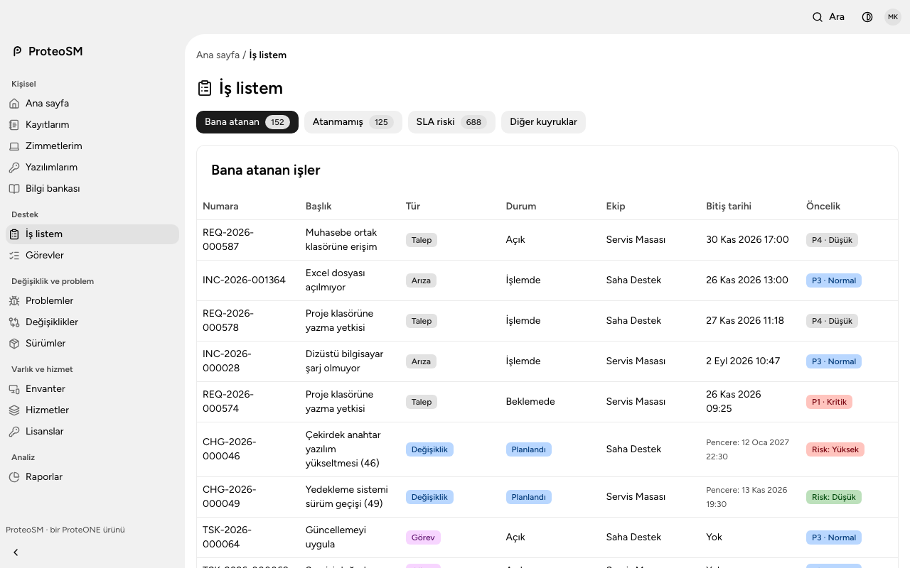
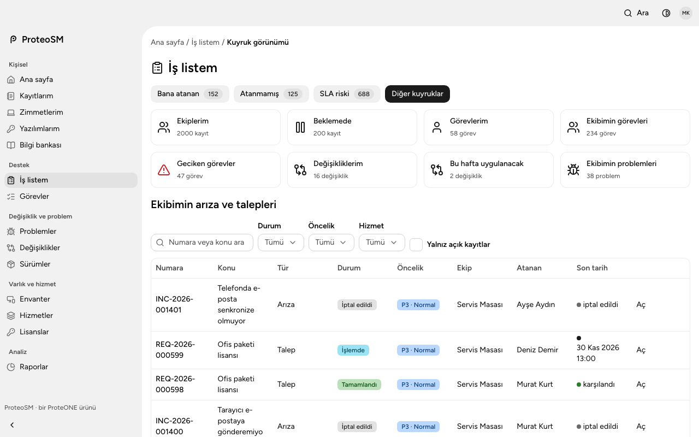
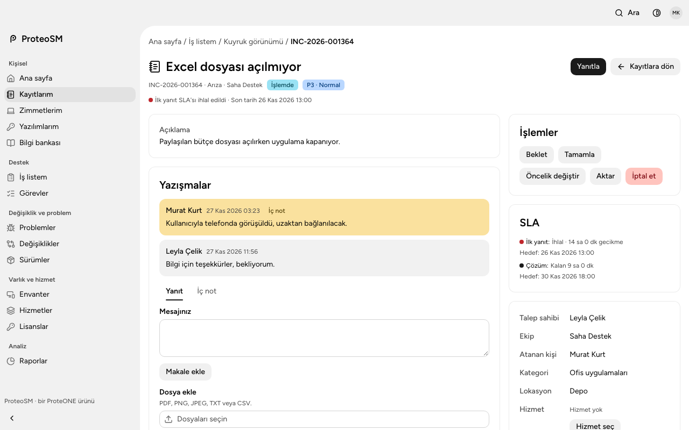
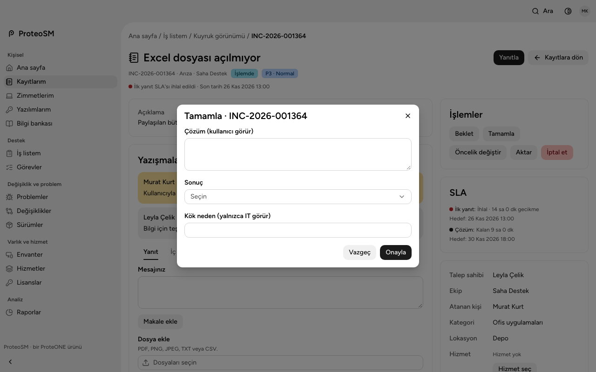
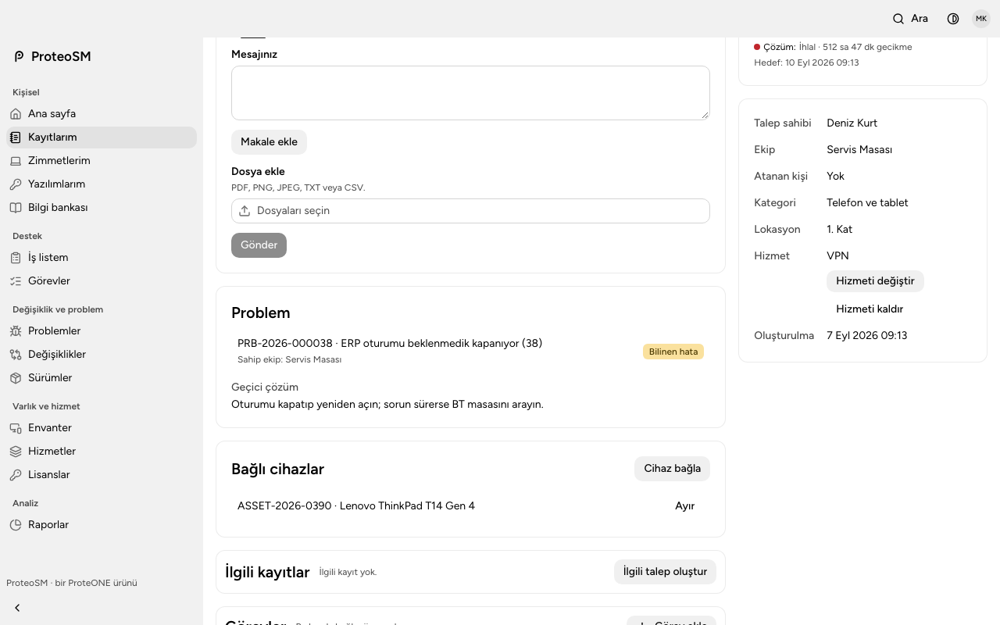

# IT iş listesi

Bu sayfa IT personeli ve yöneticiler içindir: size ve ekiplerinize düşen kayıtları bulmak, üzerinize almak ve çözmek.

## İş listem

Menüden **İş listem** sayfasını açın. Sayfa en üstte üç sayaçlı görünümle açılır:

| Görünüm | İçindekiler |
|---|---|
| **Bana atanan** | Size atanmış arıza, talep, görev ve değişikliklerin tek listesi. Sayfa bununla açılır. |
| **Atanmamış** | Ekiplerinizde henüz kimsenin üzerine almadığı arıza ve talepler. |
| **SLA riski** | SLA hedefi yaklaşan veya geçmiş açık arıza ve talepler; hedef zamanı en yakın olan en üstte. Önce bunlara bakın. |
| **Diğer kuyruklar** | Düğmeye basınca diğer kuyruk kartları açılır (aşağıya bakın). |

Düğmedeki rozet kayıt sayısını gösterir; sayı alınamazsa "sayı alınamadı" yazar. Listenin başlığı hangi görünümde olduğunuzu söyler (örneğin "Atanmamış arıza ve talepler"). Arıza ve talep satırlarında **Bitiş tarihi** sütunu, çalışan SLA sayaçlarından hedefi en yakın olanı gösterir.

**Diğer kuyruklar** düğmesi şu kartları açar; bir karta basınca o kuyruk açılır:

| Kart | İçindekiler |
|---|---|
| **Ekiplerim** | Üyesi olduğunuz ekiplerin kayıtları. |
| **Beklemede** | Ekiplerinizde beklemeye alınmış kayıtlar. |
| **Bu hafta uygulanacak** | Ekiplerinizin sahip olduğu, **Planlandı** veya **Uygulanıyor** durumundaki ve bakım penceresi bu hafta (pazartesiden pazara) başlayan değişiklikler. |
| **Ekibimin problemleri** | Ekiplerinizin sahip olduğu açık problemler (**Açık**, **İnceleniyor**, **Bilinen hata**). Bkz. [Problemler](problems.md). |
| **Görevlerim**, **Ekibimin görevleri**, **Geciken görevler**, **Değişikliklerim** | Görev ve değişiklik kuyrukları. Bkz. [Görevler ve değişiklikler](tasks-and-changes.md). |

Ana sayfadaki **İş kuyruklarım** bölümü de aynı kartlardan üçünü gösterir.

## Kuyruk

Kuyrukta kayıtlar tablo halinde görünür: numara, konu, tür, durum, öncelik, ekip, atanan kişi ve **Son tarih** (SLA hedef zamanı ya da sonucu). Üstteki üç görünüm düğmesi kuyruk sayfalarında da durur.

- **Numara veya konu ara**, **Durum** ve **Öncelik** ile listeyi daraltın.
- Kaydı açmak için **Aç** düğmesine basın.
- Kayıttan sayfa yolundaki **Kuyruk görünümü** adımıyla veya **Kayıtlara dön** düğmesiyle aynı filtrelerle listeye dönersiniz.

Kayıt sayfasındaki SLA kartında iki ölçü vardır: **İlk yanıt** ve **Çözüm**. "Kalan 4 sa 0 dk" hedefe kalan mesai süresini, "Risk" hedefin yaklaştığını, "İhlal" hedefin geçtiğini, "Duraklatıldı" sürenin beklemede durduğunu gösterir.

## Kayıt üzerinde çalışma

Kaydı açınca başlıkta kaydın konusu, altında numara, tür, ekip, durum, öncelik ve tek bir SLA satırı (örneğin "İlk yanıt SLA'sı risk altında · Son tarih 26 Kas 2026 13:00") görünür. Başlığın sağındaki ana düğme kayda göre değişir: atanmamış kayıtta **Üzerime al**, atanmış kayıtta **Yanıtla**. **Üzerime al**'a basınca düğme **Yanıtla**'ya döner ve klavye odağı ona geçer; **Yanıtla** yanıt sekmesini açıp imleci mesaj alanına koyar. Sağda **İşlemler** kartı görünür. Kartta yalnızca kaydın o anki durumunda yapılabilecek işlemler çıkar.

| İşlem | Ne yapar |
|---|---|
| **Üzerime al** | Kaydı kendinize atar. Atanmamış kayıtlarda görünür; başlıktaki ana düğmeyle aynı işlemdir. |
| **Başla** | **Açık** kaydı **İşlemde** yapar. |
| **Beklet** | Kaydı **Beklemede** yapar. **Bekleme nedeni** seçin; **Diğer** seçerseniz **Not** yazmak zorunludur. |
| **Devam et** | Bekleyen kaydı tekrar çalışmaya alır. Yönetici onayı bekleyen taleplerde görünmez; onları onay açar. |
| **Tamamla** | Kaydı kapatır (aşağıya bakın). |
| **Öncelik değiştir** | **Etki** ve **Aciliyet** seçin; öncelik bunlardan hesaplanır. |
| **Aktar** | Kaydı başka ekibe veya kişiye verir. **Hedef ekip**, **Atanacak kişi** (ya da **Ekipte kimse**) ve **Aktarma nedeni** seçin. |
| **İptal et** | Kaydı iptal eder. **Neden** yazmak zorunludur. |
| **Onayı geçersiz kıl** | Onaylanmış talebin onayını iptal eder; talep yeniden onaya düşer. |

Beklemeye almak bazı nedenlerde SLA süresini durdurur (hangi nedenlerin durdurduğunu yönetici belirler). Aktarma SLA süresini sıfırlamaz.

## Kaydı tamamlama

1. **Tamamla** düğmesine basın.
2. **Çözüm (kullanıcı görür)** alanına ne yaptığınızı kullanıcının anlayacağı dille yazın.
3. Arızalarda **Sonuç** seçin: **Çözüldü** ya da **Hizmet talebi gerekli**.
4. İsterseniz **Kök neden (yalnızca IT görür)** alanını doldurun. Çalışan bunu görmez.
5. **Onayla** düğmesine basın.

Kurallar:

- **Hizmet talebi gerekli** seçmek için önce kayda bağlı bir talep olmalıdır (**İlgili talep oluştur**).
- Onay gerektiren bir talep, onaylanmadan tamamlanamaz.
- Tamamlanan kayıt yeniden açılmaz; yazışma eklenebilir.

## Kullanıcıya yanıt ve iç not

Kayıt sayfasındaki **Yazışmalar** bölümünde iki sekme vardır:

- **Yanıt**: Kullanıcı görür ve e-posta alır. Kayda yazdığınız ilk yanıt **İlk yanıt** SLA süresini durdurur.
- **İç not**: Yalnızca IT personeli görür. Sarı zeminle gösterilir.

Her sekmenin kendi taslağı vardır: iç not olarak yazdığınız metin sekme değişince kullanıcıya giden yanıta dönüşmez.

Mesajı **Mesajınız** alanına yazın, gerekirse **Dosya ekle** ile dosya ekleyin ve **Gönder** düğmesine basın. **Makale ekle** ile bilgi bankasından bir makalenin bağlantısını mesaja ekleyebilirsiniz; kullanıcıya giden yanıta yalnızca çalışanlara açık makaleler eklenebilir.

## Cihaz, ilgili talep ve makale bağlama

- **Bağlı cihazlar** kartında **Cihaz bağla** ile envanterden bir cihazı kayda bağlayın (**Demirbaş no ile ara**). **Ayır** bağlantıyı kaldırır.
- **İlgili kayıtlar** kartında **İlgili talep oluştur**, bir arızadan yeni bir talep açar; örneğin onarılamayan bir bilgisayar için "Yeni bilgisayar" talebi. Yeni talep arızaya bağlı görünür.
- **İlgili değişiklikler** kartı kayda bağlı değişiklikleri gösterir. Bağlantı değişiklik sayfasından kurulur (bkz. Görevler ve değişiklikler, İlgili kayıtlar).
- **Problem** kartı yalnızca arızalarda görünür. Arıza bir probleme bağlıysa problemin numarasını, durumunu, sahip ekibini ve **Geçici çözüm** metnini gösterir; aynı hata tekrar ediyorsa önce bu geçici çözümü deneyin. Bağlı değilse **Probleme bağla** ile problem numarasını yazıp bağlayın veya **Problem oluştur** ile arızanın konusu ve açıklamasıyla dolu yeni bir problem açın. Bkz. [Problemler](problems.md).

  

- **İlgili makaleler** kartında **Makale bağla** ile çözümü anlatan makaleyi kayda bağlayın.

Kaydın bilgilerindeki **Hizmet** alanı, kaydın ilgili olduğu hizmeti gösterir; **Hizmet seç** ile seçin. Kuyruk listesini **Hizmet** filtresiyle daraltabilirsiniz (bkz. [Hizmetler](services.md)).

## İpuçları

- Güne **SLA riski** görünümüyle başlayın.
- Kullanıcıdan bilgi beklerken kaydı **Beklet** ile **Kullanıcıdan yanıt bekleniyor** nedeniyle bekletin; kullanıcı yanıt yazınca **Devam et** ile sürdürün.
- Başka biri kaydı siz düzenlerken değiştirdiyse "Bu kayıt siz düzenlerken başka biri tarafından değiştirildi" uyarısı çıkar. Sayfayı yenileyip tekrar deneyin.
