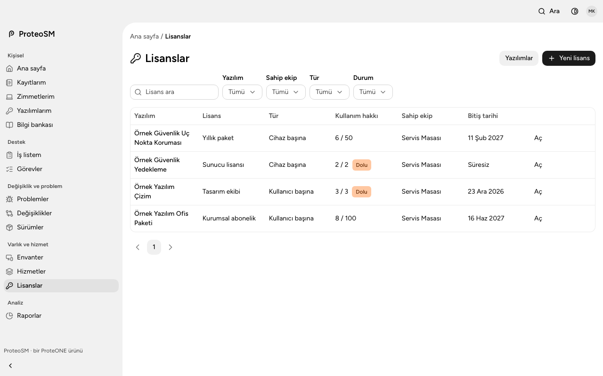
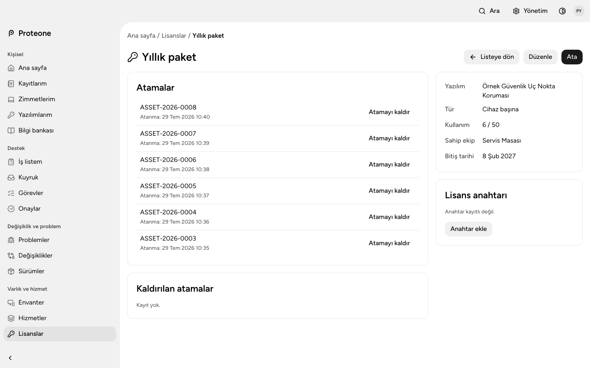

# Yazılım ve lisanslar

Çalışanlar yalnızca kendi yazılımlarını görür. Yazılım, lisans ve atamaları IT personeli ve yöneticiler yönetir.

## Yazılımlarım

Menüden **Yazılımlarım** sayfasını açın. Size veya üzerinizdeki cihaza atanmış yazılımların adı ve üreticisi listelenir. Eksik bir yazılım için [talep oluşturun](incidents-and-requests.md).

## Yazılım tanımlama

1. **Lisanslar** sayfasında **Yazılımlar** düğmesine basın.
2. **Yeni yazılım** düğmesine basın, **Üretici** ve **Yazılım** alanlarını doldurun.
3. **Oluştur** düğmesine basın.

Aynı üretici ve adla ikinci yazılım açılmaz. Kullanılmayan yazılımı **Düzenle** ile pasife alın; pasif yazılıma yeni lisans eklenmez, eski lisanslar kalır.

## Lisans listesi

**Lisanslar** sayfası her lisansın türünü, kullanımını, sahip ekibini ve bitiş tarihini gösterir. **Yazılım**, **Sahip ekip**, **Tür** ve **Durum** ile listeyi daraltın.

## Lisans ekleme

1. **Yeni lisans** düğmesine basın.
2. Yazılımı **Yazılım ara** ile bulup seçin. **Tür** alanında lisansın kullanıcı başına mı cihaz başına mı olduğunu seçin; bu ikisi sonradan değişmez.
3. **Lisans** adını, **Adet** ve **Sahip ekip** alanlarını doldurun. Süreli lisansta **Bitiş tarihi** girin.
4. **Oluştur** düğmesine basın.

## Atama

1. Lisansı açın, **Ata** düğmesine basın.
2. Kullanıcıyı veya cihazı arayıp seçin, **Ata** düğmesine basın.

- Boş hak kalmadıysa veya süre bittiyse yeni atama yapılamaz. Var olan atamalar kalır.
- Pasif kullanıcıya, kullanım dışı veya kayıp cihaza atama yapılamaz. Sonradan bu duruma düşen atamanın yanında **Kullanılamıyor** yazar; **Atamayı kaldır** ile hakkı boşaltın.
- **Adet**, kullanılan hak sayısından az olamaz.
- Cihazın lisansları cihaz sayfasındaki **Lisanslar** kartında da görünür.

## Bitiş e-postası

Bitişe, **Genel ayarlar** sayfasında seçilen gün sayısı (başlangıçta 30) kala sahip ekibin aktif üyelerine bir e-posta gider. Süre daha azsa e-posta hemen gider. Bitiş tarihi değişirse yeni tarih için yeniden gider.

## Lisans anahtarı (yönetici)

Yönetici lisans sayfasında **Anahtar ekle** ile anahtarı kaydeder, **Anahtarı göster** ile görür. Her görüntüleme denetim kaydına yazılır. Anahtar listelerde, aramada, raporlarda ve Excel dosyalarında yer almaz.

## Rapor

**Raporlar** sayfasının **Lisanslar** sekmesi tüm, dolu, süresi biten ve 30, 60, 90 gün içinde bitecek lisansları sayar. Rakama basınca lisanslar ve kullanımları listelenir; liste Excel'e aktarılabilir.

## İpuçları

- Ayrılan kişinin atamalarını kaldırın; boşalan hak hemen yeniden kullanılabilir.
- Bitiş tarihini boş bırakırsanız lisans **Süresiz** görünür ve e-posta gitmez.
