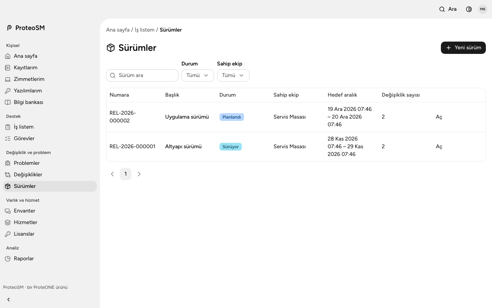
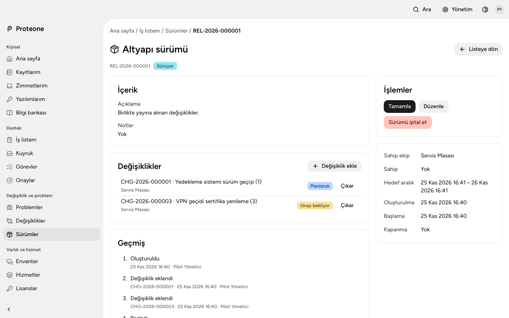

# Sürümler

Bu sayfa IT personeli ve yöneticiler içindir. Sürüm, birlikte yayına çıkan değişiklikleri tek kayıtta toplar. Sürümün onayı yoktur; her değişiklik kendi onayı, penceresi ve görevleriyle yürür.

## Sürüm listesi

Menüde **Sürümler** sayfasını açın. Liste durumu, sahip ekibi, hedef aralığı ve değişiklik sayısını gösterir.

## Sürüm açma

1. **Yeni sürüm** düğmesine basın.
2. **Başlık**, **Açıklama** ve **Sahip ekip** alanlarını doldurun. Sahip, hedef aralık ve not isteğe bağlıdır.
3. **Oluştur** düğmesine basın.

Sahip ekip, üyesi olduğunuz bir ekip olmalıdır; yöneticiler her aktif ekibi seçebilir.

## Değişiklik ekleme ve çıkarma

1. Sürüm sayfasında **Değişiklik ekle** düğmesine basın, numarayı yazın.
2. Yanlış eklenen değişikliği **Çıkar** ile sürümden çıkarın.

- Bir değişiklik tek sürümde olabilir. Kapalı veya iptal edilmiş değişiklik eklenmez.
- Değişikliği ekleyen kişi hem sürümde hem değişiklikte çalışabilmelidir.
- Sürüme eklemek değişikliğin planını, onayını ve durumunu değiştirmez. Değişiklik sayfasında **Sürüm** alanı görünür.
- Görme yetkiniz olmayan değişikliğin yalnızca numarası, başlığı, durumu ve ekibi çıkar.

## Yürütme

| Düğme | Ne yapar |
|---|---|
| **Başlat** | Sürümü **Sürüyor** durumuna alır. |
| **Tamamla** | En az bir değişiklik varsa ve hepsi kapalı veya iptalse sürümü kapatır. |
| **Sürümü iptal et** | Neden ister; değişiklikler sürümden çıkar, kendi durumlarını korur. |

Bu düğmeleri yöneticiler ve sahip ekibin üyeleri görür. **Geçmiş** bölümü her adımı gösterir.
