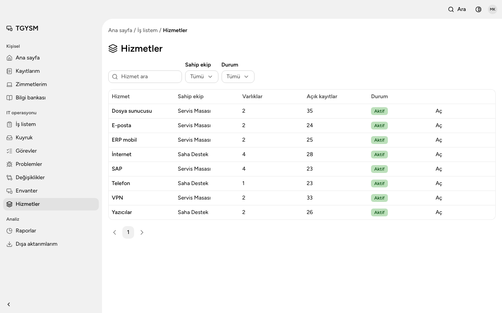
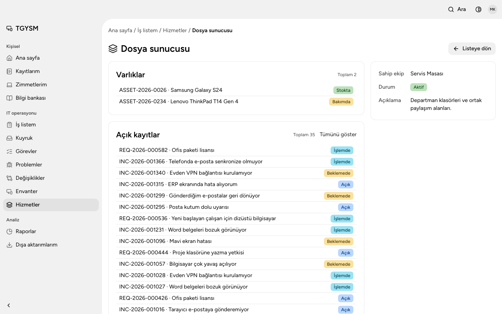
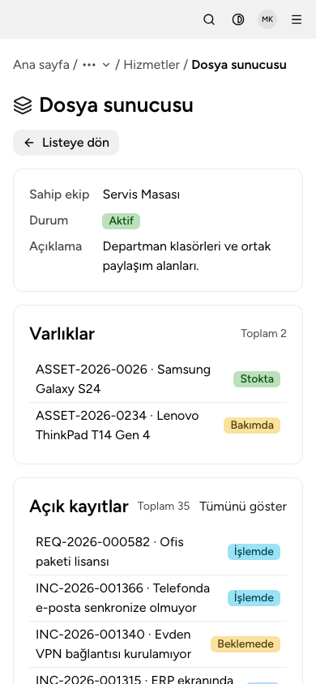
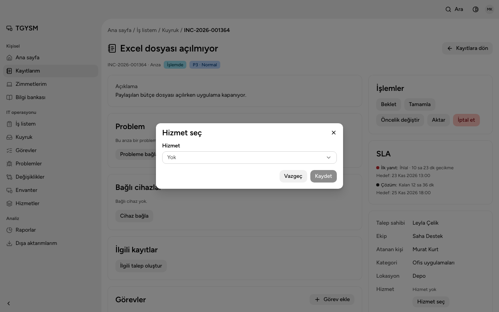
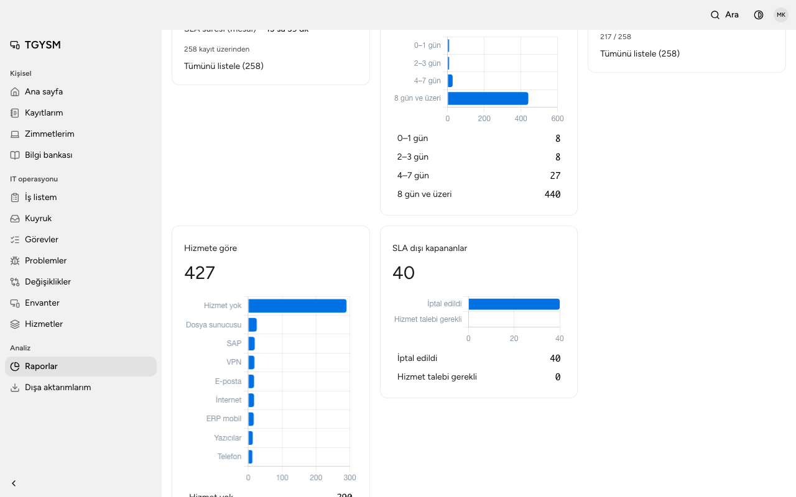
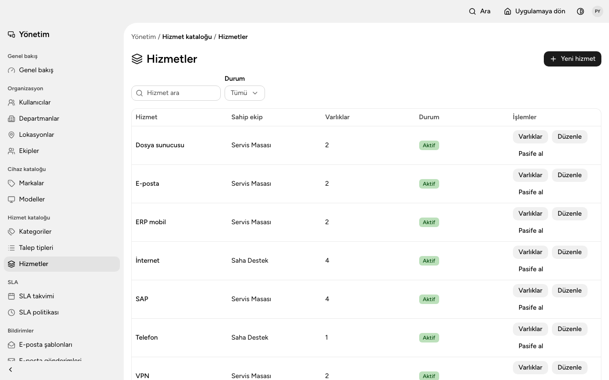
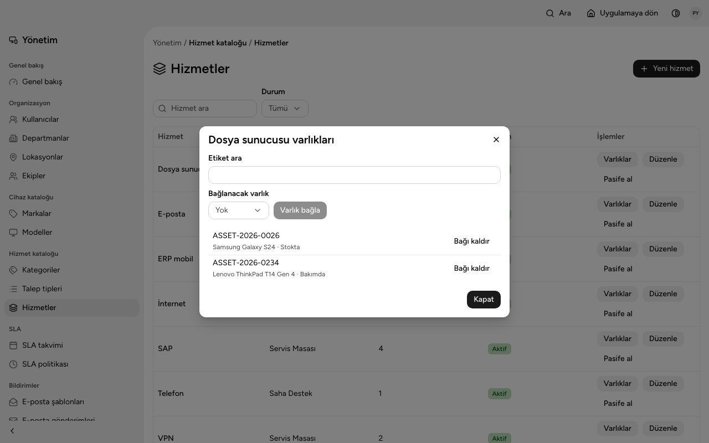

# Hizmetler

Bu sayfa IT personeli ve yöneticiler içindir. Çalışanlar hizmetleri görmez; kayıtlarında da **Hizmet** alanı çıkmaz.

Hizmet, şirketin kullandığı bir sistem veya altyapıdır (örneğin e-posta, VPN, SAP). Hizmet sayfası o hizmetin cihazlarını, açık kayıtlarını, süren değişikliklerini ve açık problemlerini tek yerde gösterir. Hizmet bir kaydı yönlendirmez; ekibi, önceliği veya SLA süresini değiştirmez.

## Hizmet listesi

Menüde **Hizmetler** sayfasını açın. Liste sahip ekibi, bağlı varlık sayısını, açık kayıt sayısını ve durumu gösterir. **Hizmet ara**, **Sahip ekip** ve **Durum** ile listeyi daraltın. Hizmeti açmak için **Aç** bağlantısına basın.

## Hizmet sayfası ve etki görünümü

| Bölüm | İçindekiler |
|---|---|
| **Varlıklar** | Hizmete bağlı cihazlar ve durumları. Emekliye ayrılan veya kaybolan cihaz da bağı kaldırılana kadar görünür. |
| **Açık kayıtlar** | Hizmeti seçilmiş, kapanmamış arıza ve talepler. |
| **Değişiklikler** | Onay bekleyen, planlanan, uygulanan ve doğrulanan değişiklikler. |
| **Açık problemler** | Çözülmemiş ve iptal edilmemiş problemler. |

Her bölüm en fazla 20 satır gösterir; toplam sayı başlığın yanındadır. Daha çok kayıt varsa **Tümünü göster** bağlantısı, hizmete göre süzülmüş listeyi açar. Görme yetkiniz olmayan kaydın yalnızca numarası, başlığı ve durumu çıkar; yanında **Açma yetkiniz yok** yazar.

## Kayda hizmet seçme

Arıza, talep, değişiklik ve problem sayfalarında **Hizmet** alanı vardır. Bir kayda tek hizmet seçilir.

1. **Hizmet** alanında **Hizmet seç** düğmesine basın.
2. Listeden hizmeti seçin ve **Kaydet** düğmesine basın.
3. Sonradan **Hizmeti değiştir** ile başka hizmet seçin veya **Hizmeti kaldır** ile alanı boşaltın.

- Arıza veya talebe bağlı cihazlar tek bir aktif hizmete aitse pencerede "Önerilen: VPN" gibi bir satır çıkar ve o hizmet seçili gelir. Siz **Kaydet** düğmesine basmadan hiçbir şey kaydedilmez.
- Yalnızca aktif hizmetler seçilebilir. Kayıttaki hizmet sonradan pasife alınırsa kayıtta kalır ve yanında **Pasif** yazar.
- Kapanmış kayıtlara da hizmet seçilebilir. Kaydın durumu, SLA süresi ve değişikliğin onayı bundan etkilenmez.
- Arıza ve taleplerde kaydı gören her IT personeli hizmet seçebilir. Değişiklik ve problemlerde sahip ekibin üyesi veya yönetici olmalısınız.
- Değişiklikteki **Etkilenen hizmet** ayrı bir metin alanıdır; pencere çakışması uyarısı o metne bakar.

## Listelerde ve raporlarda hizmet

**Kuyruk**, **Değişiklikler** ve **Problemler** listelerinde **Hizmet** filtresi vardır. **Ara** penceresi hizmetleri ad ve açıklamaya göre bulur.

**Raporlar** sayfasının **Olaylar**, **Talepler**, **Değişiklikler** ve **Problemler** sekmelerinde **Hizmete göre** kartı, dönemde açılan kayıtları hizmete göre sayar. Hizmeti seçilmemiş kayıtlar **Hizmet yok** satırındadır. Bir satıra basınca arkasındaki kayıtlar açılır.

## Hizmet tanımlama (yönetici)

Yönetim ekranında **Hizmet kataloğu** altındaki **Hizmetler** sayfasını açın.

1. **Yeni hizmet** düğmesine basın.
2. **Hizmet** adını ve **Sahip ekip** alanını doldurun; isterseniz **Açıklama** yazın. Hizmet adı tek olmalıdır.
3. **Oluştur** düğmesine basın.

**Düzenle** ile bilgileri değiştirin. Kullanılmayan hizmeti **Pasife al** ile kapatın; **Aktif et** ile geri açın. Hizmet silinmez, eski kayıtlar hizmetini korur.

## Varlık bağlama (yönetici)

1. Hizmetin satırında **Varlıklar** düğmesine basın.
2. **Etiket ara** alanına demirbaş etiketini yazın, **Bağlanacak varlık** listesinden cihazı seçin.
3. **Varlık bağla** düğmesine basın. Yanlış bağı **Bağı kaldır** ile silin.

Bir cihaz birden çok hizmete bağlanabilir. Emekliye ayrılan veya kaybolan cihaz yeni bir hizmete bağlanamaz. Bağlar cihaz sayfasındaki **Hizmetler** kartından da yönetilir (bkz. [Envanter](inventory.md)).

## İpuçları

- Yaygın bir kesintide önce hizmet sayfasına bakın; aynı nedenli arızaları ve o gün uygulanan değişikliği birlikte görürsünüz.
- Cihaz bağlarını güncel tutun; hizmet önerisi bu bağlardan gelir.
